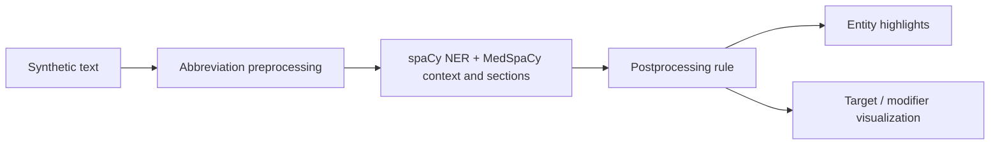

# Medical term and context explorer

A legacy Streamlit demo for inspecting MedSpaCy annotations in short, synthetic text. It combines a clinical named-entity model with context rules, section detection and a small postprocessing rule, then displays entity highlights or target/modifier relationships.

This is a visualization and pipeline-learning project. It has no clinical validation, accuracy benchmark or diagnosis capability. Use synthetic examples; do not paste patient records into a public or shared instance.

## What the code demonstrates



- `dx'd` and `tx'd` preprocessing rules expand abbreviations.
- A custom context pattern labels expressions such as “diagnosed in 2020” as historical.
- Section detection uses the package's default patterns.
- A postprocessing example removes the exact entity text `married`.
- The dependency-style view uses the included `rush_rules.tsv` sentence rules. It shows context relationships, not a separately trained relationship classifier.

The app caps input at 20,000 characters. Its default text is an explicitly synthetic example. Entity categories come from the model and rules; a highlighted span is not a verified medical fact.

## Legacy environment

`requirements.txt` retains **spaCy 2.3.5**, **MedSpaCy 0.0.1.4** and **Pillow 8.0.1**. It also declares Streamlit, which was missing despite the application's import. The model is an off-registry tarball from `abchapman93/spacy_models`; its URL now names a fixed repository revision rather than mutable `master`.

Review that artifact and choose a Python/Streamlit environment compatible with these old packages before installation. A fixed URL improves repeatability; it does not establish model provenance or make an external archive trustworthy. The model archive was not downloaded, installed or executed during this review.

For a deliberately prepared compatible environment:

```sh
python -m venv .venv
source .venv/bin/activate
python -m pip install -r requirements.txt
python -m streamlit run medspacy_streamlit_final.py --server.address 127.0.0.1
```

Run from the repository root because the script reads `medspacy.jpg` and `rush_rules.tsv` by relative path. The model package must be installed under the name `en_info_3700_i2b2_2012`.

## Repository map

| File | Role |
| --- | --- |
| `medspacy_streamlit_final.py` | Streamlit controls, pipeline configuration and local visualization helpers |
| `rush_rules.tsv` | Included sentence-splitting rules, with their original license notice |
| `requirements.txt` | Legacy libraries and the pinned external model URL |
| `medspacy.jpg` | Existing sidebar illustration, not an application screenshot |

## What remains unverified

The review parsed the source, inspected repository objects and dependency declarations, and confirmed that the pinned model path exists at the referenced upstream revision. It did not install the legacy stack, load the model, launch Streamlit or capture a new UI screenshot. No recognition score or working-runtime claim is implied.

A worthwhile next step is a small synthetic fixture set for negation, historical mentions, family context and sentence boundaries, followed by a tested environment lock. Pipeline construction and model loading also happen on Streamlit reruns; caching and separation of UI from pipeline configuration would make that easier to test. Several imported visualization names are overridden by local functions, so those helpers should be separated during a runtime-verified refactor.

The repository uses the MIT license. The sentence rules retain the University of Utah notice and Apache license reference. External libraries and the model have their own terms.
